<p align="center">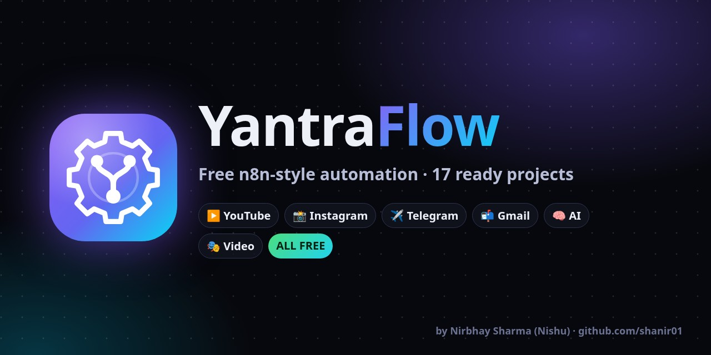</p>

<p align="center"></p>
<h1 align="center">YantraFlow</h1>
<p align="center"><b>Free, n8n-style automation platform: free account, 25 ready-made Public Projects (incl. Photo + Video Maker), an AI Project Generator (Telegram, Instagram, YouTube, X, LinkedIn auto-post with SEED + schedules), and a drag-and-drop editor — on the web, your PC <i>and</i> your Android phone (Termux).</b><br>
Drag &amp; drop nodes → AI, Telegram, Instagram Reels, YouTube upload, webhooks, schedules. Zero dependencies. Your keys never leave your device.</p>

<p align="center">
<a href="https://yantraflow.sites.tab.bot/"><b>🌐 Try it live in your browser</b></a> ·
<a href="#-website-accounts--public-projects-v2">🧩 Public Projects</a> ·
<a href="#-quick-start-pc">💻 PC setup</a> ·
<a href="#-quick-start-android-termux">📱 Phone setup</a> ·
<a href="#-hinglish-quickstart">🇮🇳 Hinglish guide</a>
</p>
<p align="center">
    
</p>

---

## Why YantraFlow?

| | YantraFlow | n8n (self-host) |
|---|---|---|
| Install | double-click `start.bat` / `sh start.sh` | Docker or `npx n8n` (heavy) |
| Runs on Android phone (Termux) | ✅ light (one Node process, ~80 MB RAM) | ⚠️ possible but heavy |
| npm dependencies | **0** | 1000+ |
| Price | Free, MIT | Free self-host (Sustainable Use License) |
| Built-in social posting | Instagram Reels, Facebook Page, YouTube upload, Telegram channel, X | via nodes |
| Works with your [FreeLLM-Router](https://github.com/shanir01/FreeLLM-Router) | ✅ default AI URL | manual |

> YantraFlow is **inspired by** n8n's idea, but it is written from scratch — no n8n code is used. n8n has far more integrations; YantraFlow is small, simple and phone-friendly.

## 🧩 What's new in v4.4

**Cleaner screens, help next to every key, and two new ways to build projects.**

- **Close buttons on every note.** The "Web version", "Localhost PREMIUM" and "schedule tabhi chalega" boxes are now ONE slim **Tips** strip (tap to open). Every tip, the admin *Setup pending* banner, project notes and announcement banners have an **X**. A closed tip stays closed (saved in your browser). **Me → Tips wapas dikhao** brings them all back.
- **Help next to every key field.** Open any node: *AI model*, *AI base URL*, *AI API key*, Telegram bot token / chat id, Instagram, Facebook, Pexels, Pixabay, Discord, Slack fields show an **example**, a one-line **"Kya daalna hai"** and a **"Kahan milega? (Guide)"** button.
- **AI provider picker.** Pick **Groq / Gemini / OpenRouter / OpenAI / SangamAI (local)** and the Base URL + recommended model fill in by themselves (Groq → `openai/gpt-oss-120b`, Gemini → `gemini-3.8-flash`, SangamAI → `http://localhost:8787/v1` + key `local`). Works on the Keys page and inside nodes.
- **A guide everywhere.** Every Keys card has a step-by-step Hinglish guide with direct links (console.groq.com/keys, aistudio.google.com/apikey, @BotFather, @userinfobot, pexels.com/api, pixabay.com/api/docs, Google Cloud + OAuth Playground, Meta Graph API Explorer, LinkedIn apps) and **common errors + fix**. Every project page has a **Guide** section: what the project does, which keys it needs (green = set, orange = missing), setup steps and errors. Editor → ⋮ → **Setup guide**.
- **AI Project Generator** (Projects page, Workflows page, Me menu). Write in Hinglish what you want, e.g. *"har subah Telegram pe motivational quote photo ke saath bhejo"*, or tap one of 6 example chips. It uses **your own AI key** from the Keys page (on PC the key stays on the server, the browser never sees it). The AI's JSON is checked against the real node list: unknown nodes/params, a bad cron, broken connections or a missing trigger go back to the AI to fix (up to 3 tries). Keys/tokens are never taken from the AI. You see a preview (steps + which keys are missing), then **Use this project**.
- **Photo + Video Maker (auto)**, a complete project. Fill **once**: topic / SEED, photo style (gradient, stock photo, dark, light), size (1080x1350 / 1080x1920 / 1080x1080), brand colours, handle, platforms (Telegram / YouTube / Instagram), daily time. It builds the workflow **and** the daily schedule. Each run: AI writes a fresh post → **Post Photo Maker** makes the image card (brand colours, optional free Pexels/Pixabay photo background, credit line added) → Auto Video Maker makes the short video → posts. No repeated inputs.
- **New node: Post Photo Maker** (`imageMaker`). Website: drawn in the browser (PNG). PC/Termux: ffmpeg + libass (PNG). Telegram sends it as a photo.
- **One clean top bar.** Logo, Workflows / Projects / Runs / Keys (Lucide icons), version badge (`v4.4 · Web` / `v4.4 · PC`), GitHub and profile menu in one row on desktop. Phone: tidy header + bottom tab bar.

Honest notes: the photo is a text + brand design card, not an AI camera photo; the video is slide-style. On the website, schedules run while the tab is open (24x7 = PC/Termux). Instagram needs a public link, so website-made photos/videos go to Instagram only from PC/Termux.

<p align="center">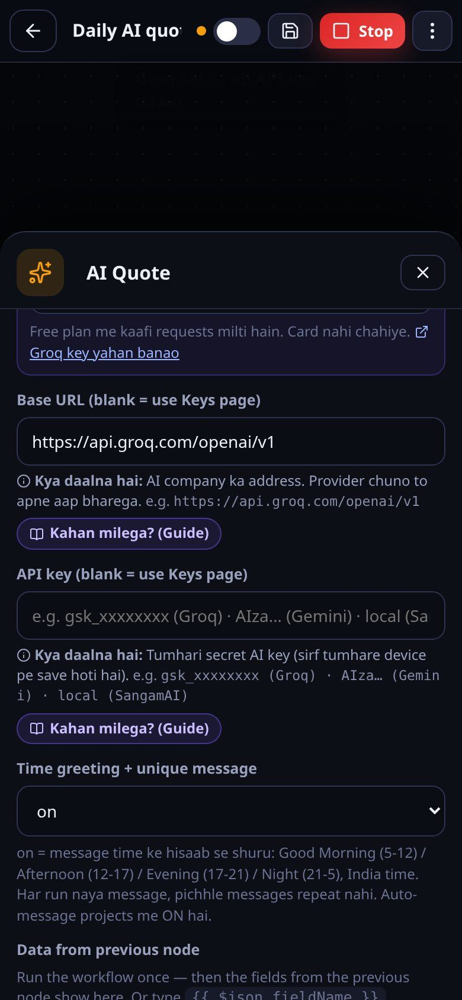 </p>
<p align="center">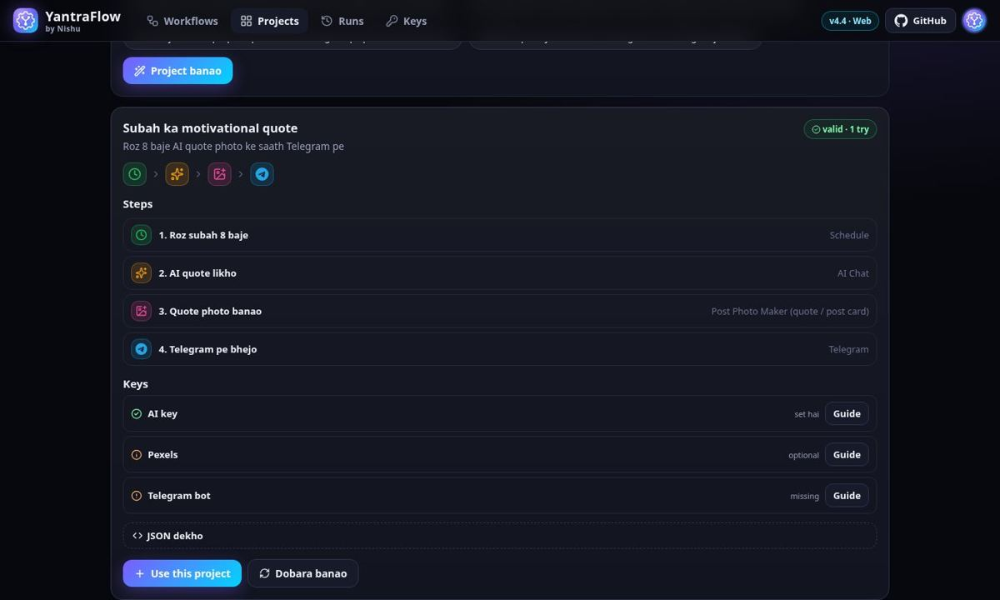</p>

**Hinglish me:** har note pe ab X hai, Me → "Tips wapas dikhao" se wapas. Har key ke neeche likha hai kya daalna hai + "Kahan milega?" guide. AI provider chuno to URL + model khud bhar jayega. "AI Project Generator" me likho kya chahiye, AI project bana dega. "Photo + Video Maker" me ek baar details do, roz khud photo + video banake post karega.

## 🎬 v4.3: Auto Video Maker + Daily Funny Video

**Video projects ab khud video banate hain** — file maangna band.

| | Website | PC / Termux (localhost) |
|---|---|---|
| **Auto Video Maker** (AI text → vertical 1080x1920 Shorts/Reels, 15–60 s, kinetic captions, gradient / photos / free stock clip background, music) | Browser me banti hai (canvas + MediaRecorder). MP4 jab browser support kare (naya Chrome / Safari), warna WebM. Tab khula rakho (20 s video ≈ 20 s). Voice nahi. | ffmpeg se **MP4 (H.264 + AAC)** + **AI voice** (edge-tts free, ya espeak offline) |
| **Video Editor** (9:16 crop, max 59 s, speed, hook text, end CTA, watermark, music) | Haan (browser me re-record) | Haan (ffmpeg) |
| **English → Hindi** (speech sun ke Hindi/Hinglish captions + Hindi voice dub, original awaaz dheemi) | Nahi | Haan: faster-whisper + tumhari AI key + edge-tts |
| **YouTube upload** | Haan (Auto Video Maker wali video ya direct link) | Haan (file / link) |
| **Instagram Reel** | Sirf PUBLIC link wali video (jaise Pexels link) | Haan, **file seedha upload** (resumable upload) |
| **Telegram video** | Haan | Haan |

Sach baat: ye **template / slide-style** videos hain (text + photos / free stock clips + music) — AI camera footage nahi.

**Kahan laga hai:** Telegram, Instagram aur YouTube SEED auto-post projects me "Auto Video Maker" step default hai (Video source = auto: tumhari apni file/link ho to wahi, warna nayi video). Sirf text chahiye to Video source = off. Try karne ke liye: website → Projects → **Auto Video Maker — abhi try karo** (`#/video-maker`).

### Naya project: Daily Funny Video → YouTube Shorts + Instagram Reels + Telegram
Topic do (funny, cats, memes, baarish…) → har run:
1. **Free Video Finder** — Pexels / Pixabay se ek NAYA free-licence vertical clip (pichhle 300 yaad, repeat nahi) ya tumhare apne clips
2. **AI Post Writer (platform: video)** — Hinglish title + caption + description + hashtags + pehla comment, time greeting ke saath; **credit line apne aap** (description + caption)
3. **Auto Video Maker** — kuch na mile to slide video bana deta hai
4. **Video Editor** — 9:16, ≤59 s, hook, CTA, watermark; English bol-chaal ho to Hindi captions (+ Hindi dub option) — PC/Termux
5. **YouTube Shorts + Instagram Reel + Telegram** — ek platform fail ho to baaki phir bhi chalte hain

> **Pinterest kyon nahi?** Pinterest / Instagram / YouTube se dusron ke videos utha ke repost karna = copyright strike (channel band ho sakta hai), aur Pinterest download API deta hi nahi, license bhi pata nahi chalta. Isliye sirf free-licence sources (Pexels License / Pixabay Content License — repost allowed) ya tumhare apne clips.

### Pexels + Pixabay free keys (2 min)
- **Pexels:** pexels.com/api → *Get Started* → login / sign up → app ka naam `YantraFlow`, use: "auto posting tool" → **API key copy** → YantraFlow → Keys → *Pexels* → paste → Save. (Free: 200 requests/ghanta, 20,000/mahina)
- **Pixabay:** pixabay.com pe free account → pixabay.com/api/docs kholo (login rehte hue) → "Parameters" me `key` ke saamne tumhari key → copy → Keys → *Pixabay* → paste → Save. (Free: 100 requests/minute)
- Ek bhi key kaafi hai. Key nahi hai to Auto Video Maker gradient background use karta hai.

## 💎 PC / Termux setup
Website pe ek note dikhta hai: *"Localhost (PC/Termux) pe chalao to aur PREMIUM options milenge"* — sab free:
24x7 schedule (tab band ho tab bhi) · Video Maker MP4 + AI voice · English → Hindi captions/dub · X, LinkedIn, Slack, Email post + Instagram file upload · unlimited link preview · folder watch, webhooks, local files.
(Admin panel → Site customise → *Localhost PREMIUM note* se ye note band ya text badal sakte ho; user ✕ se hide kar sakta hai.)

```bash
# Termux (Android)
pkg install nodejs git ffmpeg python
pip install edge-tts            # free AI voice (optional)
git clone https://github.com/shanir01/YantraFlow && cd YantraFlow && npm start
termux-wake-lock                # 24x7 ke liye
# (English -> Hindi captions ke liye faster-whisper chahiye — PC pe aasaan: pip install faster-whisper; Termux pe ye mushkil hai, wahan translate = off rakho)

# PC (Windows: winget install ffmpeg · Mac: brew install ffmpeg · Linux: sudo apt install ffmpeg)
pip install edge-tts faster-whisper
git pull && npm start
```
Videos `files/videos/` me save hoti hain. Hindi captions ke liye PC me koi Devanagari font (Noto Sans Devanagari / Mangal) hona chahiye — Windows/Android me pehle se hota hai.

## 🚀 v4: Auto-post & Schedule 24x7

**New in v4 (Nov 2026):**

| | What it does |
|---|---|
| 🔗 **Link preview → Telegram** | Paste **any** link (article, YouTube, Instagram, any website) → its preview **photo + title + description + link** is posted to your Telegram bot / channel. The photo is **downloaded and uploaded as a file**, so Telegram's `400: failed to get HTTP URL content` error is gone. Project: *Any link → preview post on your Telegram bot*. New node: **Link Preview**. Telegram node: new send type **linkPreview**. |
| 📤 **Telegram media fix** | Telegram node → **Media sending** = `auto` (default): first sends the link; if Telegram can't open it, YantraFlow downloads the photo/video and uploads the bytes. `upload` = always upload, `url` = old behaviour. |
| 🌱 **SEED projects** | 5 new ready projects: **Telegram, Instagram, YouTube, X (Twitter), LinkedIn** auto-post. Each has an **AI Post Writer (seed)** node: paste your SEED document (brand info, topics, links, style, what NOT to say) or **Upload .txt / .md / .pdf**. The AI writes only from the seed. |
| ✨ **Auto message generate** | `Auto message generate = on` → every run the AI writes a **new, different** post. It remembers the last N posts (default 20) and re-writes if a draft is too similar. `off` → sends your fixed message. Optional **Photos / videos to rotate** list → next item each run (`{{ $json.media }}`). |
| ⏰ **Schedule on Run** | Press **Run** → choose **Run once** / **Repeat every N minutes / hours / days** / **Daily at HH:MM** (timezone, default `Asia/Kolkata`) → **Start schedule**. Shows next-run time, run count and a run log. **Stop** any time. Minimum gap **30 minutes** (anything faster is raised to 30 — spam/ban safety for Telegram, LinkedIn, X…). |
| ⏹ **Run ⇄ Stop button** | While a schedule is ON or a run is going on, the **Run** button (editor + every workflow card) turns into a red **Stop** button. Press **Stop** → the schedule stops and a run in progress is cancelled (status *Stopped*), and the button turns back into **Run**. It stays correct after a page reload and is the same in the editor and the list. Works on the website and on PC/Termux. |
| 👋 **Time greeting** | AI Post Writer → **Time greeting** = `on` (default): every auto-generated post starts with the right greeting for India time — **Good Morning** (5–12), **Good Afternoon** (12–17), **Good Evening** (17–21), **Good Night** (21–5). The wording changes every time (*Suprabhat*, *Good morning doston*, *Shubh sandhya*, *Raat ka wrap-up*…) and never reuses a recent opening; the time of day goes into the AI prompt so the content fits (morning motivation, night wrap-up). Website + PC/Termux scheduler. `off` = no greeting. |
| 🔁 **Keeps running by itself** | Fixed: "Run runs once and stops". A started schedule keeps running without pressing Run again. |

### Where does it run 24x7? (honest)

- **Website** (yantraflow.sites.tab.bot): the schedule runs **only while that browser tab is open** (browsers stop pages that are closed). Your schedule is saved in the browser and resumes when you open the site again (a missed run runs once). A yellow note in the app says this.
- **PC / Termux (full version)**: runs **24x7** as long as YantraFlow is on. Schedules are saved in `data/schedules.json` and **resume automatically after a restart**. Missed runs (PC was off) run once, then the normal gap continues.
  - Termux: `start.sh` already calls `termux-wake-lock`. Also turn off battery optimisation for Termux (Android Settings → Apps → Termux → Battery → Unrestricted).
  - Auto-restart if it ever stops: `KEEP_ALIVE=1 NO_BROWSER=1 sh start.sh`
  - Start on phone boot: install **Termux:Boot**, then `mkdir -p ~/.termux/boot && printf '#!/data/data/com.termux/files/usr/bin/sh\ntermux-wake-lock\ncd ~/YantraFlow && KEEP_ALIVE=1 NO_BROWSER=1 sh start.sh\n' > ~/.termux/boot/yantraflow && chmod +x ~/.termux/boot/yantraflow`
  - Windows: put a shortcut to `start.bat` in `shell:startup`, or use `npx pm2 start src/server.js --name yantraflow`.

### Posting needs each platform's own keys (no fake success)

| Platform | What you need (Keys page) | Website | PC / Termux |
|---|---|---|---|
| **Telegram** | Bot token from @BotFather + chat ID / `@channel` (bot = admin) | ✅ | ✅ |
| **Instagram** | Business/Creator account linked to a Facebook Page + Meta developer app + long-lived token with `instagram_content_publish` + IG user ID. Media must be a **public https link**. | ✅ | ✅ |
| **YouTube** | Google Cloud project, YouTube Data API v3, OAuth client + **refresh token** (scope `youtube.upload`). ≈6 uploads/day free quota. Community posts are not in the API. | ❌ | ✅ |
| **X (Twitter)** | developer.x.com app (Read+Write) — API key/secret + access token/secret. **Posting through the X API is paid** (paid plan / credits). | ❌ (X blocks browsers) | ✅ |
| **LinkedIn** | linkedin.com/developers → app → products *Share on LinkedIn* + *Sign In with LinkedIn using OpenID Connect* → token with `w_member_social openid profile` (≈60 days). Optional *Author URN*, *API version* (YYYYMM, default 202610). | ❌ (LinkedIn blocks browsers) | ✅ |

If a key is missing or wrong, the node fails with the platform's own error — it never pretends it posted.

### Link preview on the website (proxy)

Browsers can't read other websites (CORS), so the **website** asks a metadata service:
1. your own **Supabase Edge Function** (Keys page → *Link preview* → proxy URL), else
2. the free public **microlink.io** API (no key, ~50 links/day), and for YouTube links the YouTube oEmbed.
Photos are fetched directly, through your proxy, or through the free `images.weserv.nl` image proxy, then **uploaded** to Telegram.
The **PC/Termux version reads pages itself** — no limit, no proxy.

Deploy your own unlimited proxy (free Supabase plan is enough):
```bash
npm i -g supabase            # or: npx supabase ...
supabase login
supabase link --project-ref <your-project-ref>
supabase functions deploy link-preview --no-verify-jwt   # code: supabase/functions/link-preview/index.ts
```
Then paste `https://<your-project-ref>.supabase.co/functions/v1/link-preview` on the Keys page.

### Hinglish mein (short)
1. **Projects** → *Telegram auto-post (SEED se)* → **Ye project use karo**.
2. *AI Post Writer (seed)* node kholo → SEED box me apna brand/topic/style likho ya **Upload** dabao.
3. **Keys** page: AI (Groq/Gemini key) + Telegram bot.
4. **Run** → *Repeat* → `30 minute` (ya *Daily at* `09:00`) → **Start schedule**. Har baar naya post jayega.
5. 24x7 chahiye? PC/Termux pe `sh start.sh` chalao — website tab band hone pe ruk jati hai.

## 🛡 Admin panel (v4.2)

Open **https://yantraflow.sites.tab.bot/#/admin** (or **Me → Admin panel**). Only admins can open it: `shanir01.ai@gmail.com` always, plus emails in `window.YF_ADMIN_EMAILS` (`public/config.js`) and users you make admin from the panel. Everyone else sees *"Access nahi hai"*. The real lock is in Supabase: Row Level Security (`supabase/admin.sql`) and the `admin` Edge Function, which checks the caller's login token itself. **No secret key is ever in the website.**

| Tab | What it does |
|---|---|
| **Overview** | Users, cloud workflows, visits (30 days), videos + a 30-day chart |
| **Users** | List (email, signup date, last login, workflow count), search, **Block / Unblock** (real Supabase ban), **Make admin**, **Delete** |
| **Traffic** | Own first-party analytics: today / 7 days / 30 days visits + unique visitors, 30-day chart, top pages, referrers, mobile / tablet / PC split, country (from timezone). Anonymous: page, referrer site, device, a random visitor id — **no email, no user id, no IP, no full URL**. The admin's own panel visits and the local PC/Termux version are not counted. |
| **Videos** | Add a **YouTube link** or **upload an mp4** (Supabase Storage bucket `videos`, max 50 MB on the free plan), title, description, order (up / down), show / hide, edit, delete. Public page: **#/videos** (*Videos / Tutorials*, also in the footer + menu). |
| **Site customise** | Site name, logo (upload or link), primary + accent colours, hero title / subtitle (login screen + Projects page), announcement banner (on/off, text, colour), footer text, contact email, Instagram / YouTube / Telegram / GitHub links, **signups on/off** (+ message), **maintenance banner**, videos page on/off, analytics on/off. Saved to `site_settings` and applied for every visitor on load (defaults if the table is missing). |
| **Setup** | Checks what is missing in Supabase (tables, buckets, function, admin) and shows the steps with **Copy** buttons. A yellow *Setup pending* banner shows on every tab until it's all green. |

### Admin setup (one time, ~5 min, from your phone or PC)

**Step 1 — SQL (tables + security)**
1. Supabase Dashboard → your project → **SQL Editor** → **New query**
2. Paste the whole of [`supabase/admin.sql`](supabase/admin.sql) (Admin panel → Setup → **SQL copy karo** copies it for you) → **Run**
3. "Success. No rows returned" = done. Safe to run again.

It creates `profiles` (blocked / is_admin / last login), `site_settings`, `page_views`, `videos`, the storage buckets `videos` + `site`, and RLS so only admins can read users/traffic or change settings/videos.

**Step 2 — Edge Function `admin` (users list / block / delete)**
- *Dashboard:* **Edge Functions → Deploy a new function → Via Editor** → name **`admin`** → paste [`supabase/functions/admin/index.ts`](supabase/functions/admin/index.ts) (Setup → **Function code copy karo**) → **Deploy** → open the function's settings → **Verify JWT / Enforce JWT = OFF** → Save. (The function verifies the login token itself.)
- *CLI:* `supabase functions deploy admin --no-verify-jwt --project-ref kpmafhsvyozulwcuprpu`
- The service key is given to the function by Supabase automatically (`SUPABASE_SERVICE_ROLE_KEY`). Never paste it in the website. If your project has no legacy service key, add a function secret `SB_SECRET_KEY` = your **secret** key (Project Settings → API Keys). Optional secret `ADMIN_EMAILS` = more admin emails, comma separated.

<p align="center">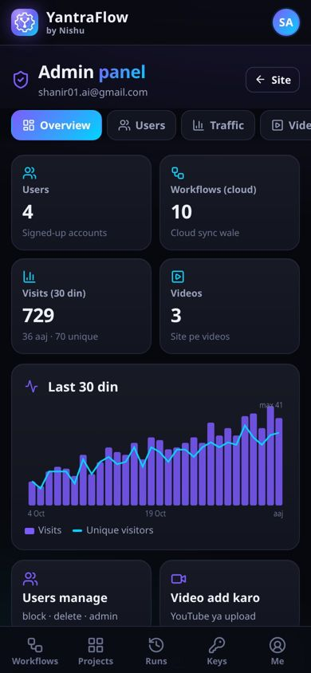 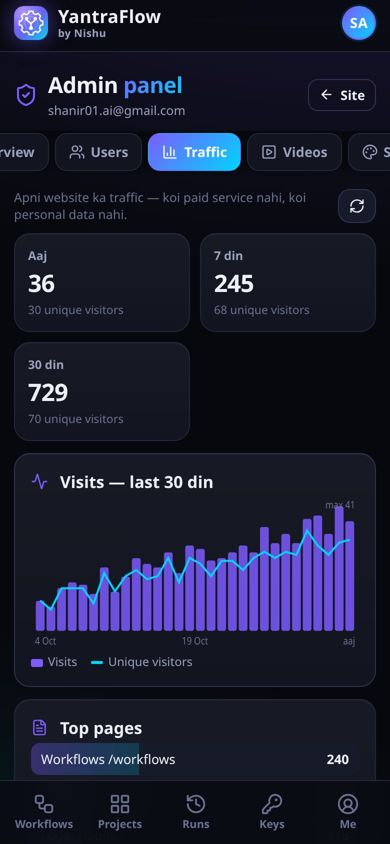</p>

**Step 3 —** open `#/admin` → **Setup** → *Dobara check karo* → all green.

Optional: run [`docs/supabase-setup.sql`](docs/supabase-setup.sql) too (cloud sync), so the Users tab can show workflow counts. To stop signups for real, also turn off Authentication → Sign In / Providers → *Allow new users to sign up*.

Without the SQL the site works exactly as before (default look); without the function the Users tab still lists users from the database, Block works as a website login block and Make admin works — only Delete and the hard ban need the function.

**Hinglish:** Supabase → SQL Editor → `admin.sql` paste → Run. Phir Edge Functions → naya function `admin` → code paste → Deploy → Verify JWT OFF. Bas. Admin panel ka Setup tab sab green dikhayega.

## 📸 Screenshots

<p align="center">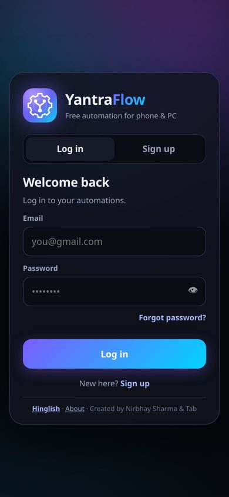 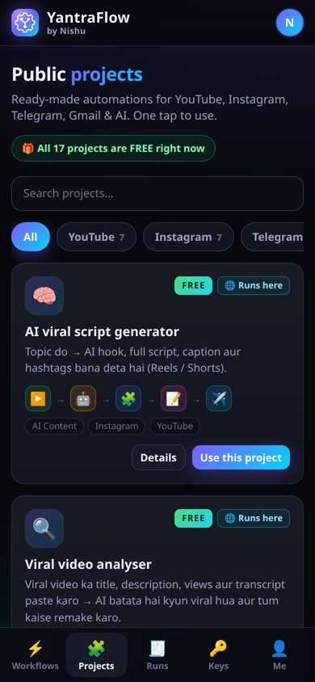 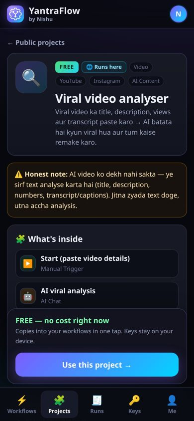 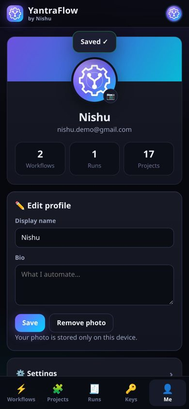</p>

<p align="center">
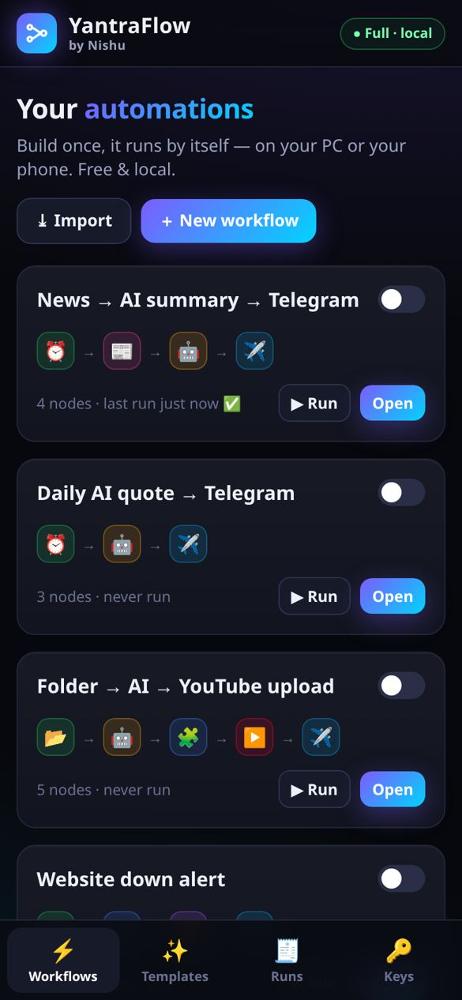 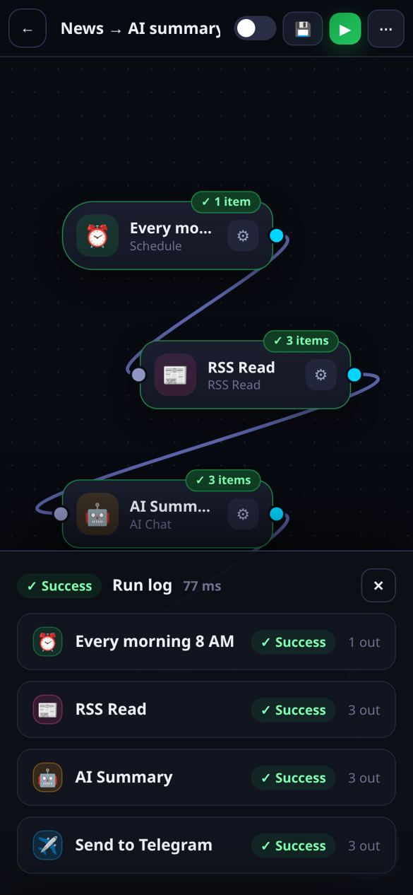 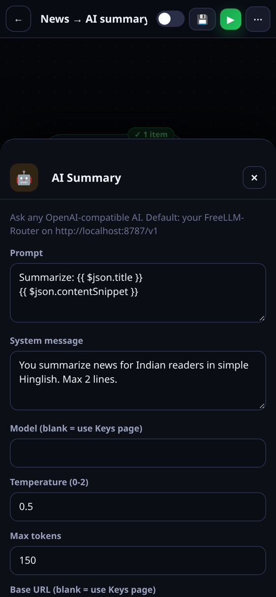 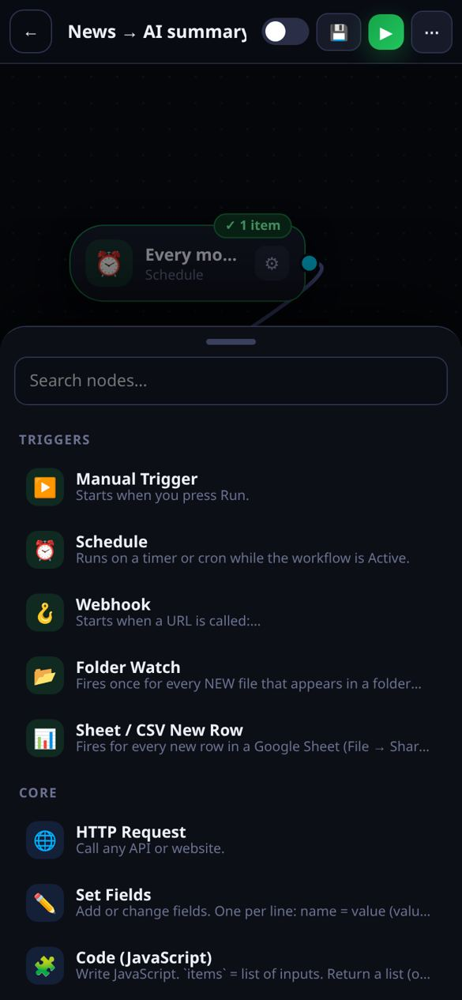
</p>
<p align="center">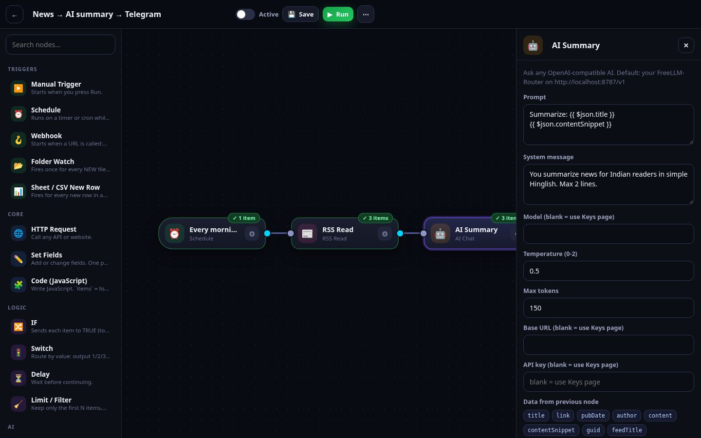</p>

## ✨ Features

- 🎨 **Visual drag-and-drop editor** (works with touch on phones — tap ＋ to add, ⚙ to edit)
- ▶️ **Run & see every node's output** — green ✓ / red ✗ badges, item counts, full JSON
- 🧾 **Execution log** for every run (last 300 kept)
- ⏰ **Triggers:** Manual · Schedule (interval or cron) · Webhook · Folder Watch (new file) · Google Sheet / CSV new row
- 🧩 **Nodes:** HTTP Request · Set Fields · Code (JavaScript) · IF · Switch · Delay · Limit/Filter · AI Chat (any OpenAI-compatible API) · Telegram (text/photo/video/file) · Instagram Post (Reels/photos) · Facebook Page · YouTube Upload · X (Twitter) · Discord · Slack · Email (SMTP) · RSS Read · Read Sheet/CSV · Write File · Log · Respond to Webhook
- `{{ expressions }}` everywhere — `{{ $json.title }}`, `{{ $node["AI Chat"].json.text }}`, `{{ $today }}`
- 🔑 **Keys page** — tokens saved only on your device (`data/credentials.json`), never in workflows or exports
- ⬇⬆ **Import / export** workflows as JSON (share them with friends!)
- 📦 **6 ready templates** (below)
- 🌙 Dark premium UI, installable as an app (PWA), mobile-first
- 🪶 **Zero npm dependencies** — nothing to `npm install`, no native builds, perfect for Termux

## 📦 Templates

| Template | What it does |
|---|---|
| 📰 News → AI summary → Telegram | Every morning reads Google News RSS, AI writes a 2-line Hinglish summary, posts to Telegram |
| 💡 Daily AI quote → Telegram | 7 AM daily motivational quote to your chat/channel |
| 🪝 Webhook → AI reply | Your own AI API: `POST /webhook/ask {"message":"..."}` → `{"reply":"..."}` |
| 🎬 AI caption → Reel to Instagram + Telegram | 6 PM daily: AI caption + hashtags, posts Reel to Instagram and video to Telegram channel |
| 📤 New video in folder → YouTube | Drop a video in a folder → AI writes title/description/tags → uploads to YouTube → Telegram ping |
| 🚨 Website down alert | Checks a site every 5 min, Telegram alert if status ≠ 200 |

## 👤 Website accounts & Public Projects (v2)

The live website **https://yantraflow.sites.tab.bot/** is now a small platform:

- **Free account** — email + password only (Sign up / Log in / Forgot password). Each account gets its own workflows, runs and keys (keys stay in that browser, never on a server).
- **Profile** — avatar (initials or your photo), name, bio. **Settings**: theme (Dark / AMOLED / Light), language (English / Hinglish), Keys page, export data, delete data, change password, delete account. **About** and **Developer** pages.
- **🧩 Public Projects** — 23 ready-made automations (v4 added Link preview → Telegram and SEED auto-post for Telegram, Instagram, YouTube, X, LinkedIn) with category filters (YouTube, Instagram, Telegram, Gmail, AI Content, Video). Every project has a `tier`/`price` field in [`public/js/projects.js`](public/js/projects.js) — **all FREE right now**. One tap on **Use this project** copies it into your workflows.

| Project | Category | Where it runs |
|---|---|---|
| AI viral script generator (topic → hook, script, caption, hashtags) | AI Content | 🌐 website |
| Viral video analyser (title/description/transcript → why it went viral + remake plan) | Video | 🌐 website — analyses **text only**, it cannot watch the video |
| Profile optimiser (unique name, bio, highlights, content pillars) | Instagram / YouTube | 🌐 website |
| YouTube title, description & tags (AI SEO) | YouTube | 🌐 website |
| Weekly content calendar generator | AI Content | 🌐 website |
| Comment keyword → auto DM text generator | Instagram | 🌐 website (writes the DM text; auto-sending DMs needs Meta's Messaging API) |
| Telegram channel daily post (AI) | Telegram | 🌐 website (24×7 in full version) |
| Daily AI quote → Telegram | Telegram | 🌐 website |
| Website down alert → Telegram | Telegram | 🌐 website |
| Auto-post Reel to Instagram + Telegram at a time | Instagram | 🛠️ needs Meta app token + public video URL |
| Gmail daily inbox summary → Telegram | Gmail | 🛠️ needs your Google OAuth token (expires in 1 h) |
| 2D / 3D cartoon video with lip-sync | Video | 🔑 needs **your own** video-AI API key (paid / free trial) — not free from us |
| Trending news → AI post | AI Content | 💻 full version (many feeds block browsers) |
| News → AI summary → Telegram | Telegram | 💻 full version |
| Gmail auto-reply (AI drafts → you approve) | Gmail | 💻 full version (SMTP send) |
| Auto YouTube upload from folder (AI title/desc/tags) | YouTube | 💻 full version |
| Webhook → AI reply | AI Content | 💻 full version |

### Supabase setup (site owner)
The website uses the owner's Supabase project (`public/config.js` holds the URL + **publishable** key — safe in the browser; never put a secret key there).

1. **Make signups work instantly:** Supabase → *Authentication* → *Sign In / Providers* → *Email* → turn **OFF "Confirm email"** → Save.
   *(If you keep it ON, Supabase's built-in email sends only a few emails per hour — add your own SMTP under Authentication → Emails → SMTP Settings, e.g. Gmail App Password, Brevo or Resend.)*
2. **Links in emails (password reset):** *Authentication* → *URL Configuration* → Site URL `https://yantraflow.sites.tab.bot` and add the same to **Redirect URLs**.
3. **Optional cloud sync + "Delete my account":** paste [`docs/supabase-setup.sql`](docs/supabase-setup.sql) into *SQL Editor* → Run. It creates the `yf_workflows` table with Row Level Security (each user sees only their own rows). Without it, workflows are saved on the device and Settings says "Cloud sync is off".

## 🧭 v3: real logos + workflow actions

- **No emoji icons anymore.** Every node, trigger and service uses a real icon: brand logos for Telegram, YouTube, Instagram, Facebook, Gmail, X, Discord, Slack, RSS, Google Sheets; clean line icons for Schedule, Webhook, HTTP, Code, IF, Switch, Delay, AI Chat, Email and the rest. Same icons in the web and PC/Termux versions, in Dark / AMOLED / Light.
- **Workflow actions:** on *Your automations*, **right-click** a card (PC), **long-press** it (phone) or tap the **⋮** button → *Open in editor, Rename, Duplicate, Export (.json), Share / send to others, Delete*.
- **Share links:** *Share* makes a link (the workflow is compressed inside the link itself, nothing is uploaded). Whoever opens it gets a preview and an **Add to my workflows** button. In the PC/Termux version: **Import → From share link** and paste it. API keys are never included.

**Hinglish:** Ab emoji ki jagah asli logo. Apne workflow pe right-click (PC) ya long-press (phone) ya ⋮ dabao → Rename, Duplicate, Export, Share link, Delete. Share link kisi ko bhi bhejo, wo khol ke "Add to my workflows" dabaye.

## 🔒 Full version (PC / Termux) password
The local full version has **no accounts**. Every time you run `start.bat` / `sh start.sh`, YantraFlow prints a **new random password** in the terminal:

```
  ════════════════════════════════════════════
  🔒 YantraFlow password:  Kp7m-Xq3Z
  ════════════════════════════════════════════
```

Type it on the lock screen at `http://localhost:5679`. Restarting makes a new password (old sessions stop working). **Webhooks (`/webhook/...`) never need the password**, so outside apps can still call them. Advanced: set `YANTRAFLOW_PASSWORD=...` to use a fixed password instead.

**Hinglish:** PC/Termux version me account nahi hai. Har baar `start.bat` / `sh start.sh` chalane par terminal me naya password dikhega (`🔒 YantraFlow password: XXXX-XXXX`). Browser me lock screen pe wahi password daalo. Dobara start kiya to naya password banega. Webhooks bina password ke chalte rahenge.

## 💻 Quick start (PC)

**Windows:** install nothing first — download this repo (**Code → Download ZIP**), unzip, double-click **`start.bat`**. If Node.js is missing it installs it (winget); run `start.bat` again. Browser opens **http://localhost:5679**.

**Mac / Linux:**
```bash
git clone https://github.com/shanir01/YantraFlow.git
cd YantraFlow
sh start.sh          # or: npm start
```

## 📱 Quick start (Android, Termux)

1. Install **Termux from [F-Droid](https://f-droid.org/packages/com.termux/)** (the Play Store version is outdated).
2. In Termux:
```bash
pkg update -y && pkg install -y git
git clone https://github.com/shanir01/YantraFlow.git
cd YantraFlow
sh start.sh
```
3. Chrome opens **http://localhost:5679** automatically (Node.js is installed for you on the first run).
4. Keep it running: `start.sh` takes a Termux **wake-lock**; also set *Battery → Termux → Unrestricted* in Android settings.
5. Want Folder Watch on your phone's Movies/Download folders? Run `termux-setup-storage` once, then use `/sdcard/Movies` as the folder.

Next time just: `cd YantraFlow && sh start.sh`. Update: `git pull`.

## 🌐 Web version vs full version

[yantraflow.sites.tab.bot](https://yantraflow.sites.tab.bot/) is the same editor running **100% in your browser** (saved in browser storage). Great to try and for AI / Telegram / Instagram / Facebook / Discord / HTTP / RSS flows while the tab is open.
These need the **full version** (this repo on PC/Termux) because a browser can't do them: Webhook, Folder Watch, YouTube upload (reads a file), Email (SMTP), Write File, X and Slack (they block browser requests), and schedules that run when the tab is closed. Some RSS feeds/APIs also block browsers (CORS) — the full version has no such limit.

## 🔑 Getting your free keys

All keys go on the **Keys** page (🔑). They stay on your device.

| Service | How to get it | Free? |
|---|---|---|
| 🤖 **AI** | Easiest: run [FreeLLM-Router](https://github.com/shanir01/FreeLLM-Router) → Base URL `http://localhost:8787/v1`, key `local`, model `auto`. Or any OpenAI-compatible API, e.g. Groq `https://api.groq.com/openai/v1` + key from console.groq.com/keys (Model blank = auto: Groq `openai/gpt-oss-120b`, Gemini `https://generativelanguage.googleapis.com/v1beta/openai` → `gemini-3.8-flash`, OpenRouter `openrouter/auto`, OpenAI `gpt-4o-mini`) | Free tiers (daily limits) |
| ✈️ **Telegram** | Telegram → **@BotFather** → `/newbot` → copy token. Chat ID: send your bot a message, open `https://api.telegram.org/bot<TOKEN>/getUpdates`, copy `chat.id`. Channel: use `@channelname` and add the bot as **admin** | Free |
| 📸 **Instagram** | Needs an Instagram **Business or Creator** account linked to a **Facebook Page** + a Meta app at developers.facebook.com with `instagram_basic`, `instagram_content_publish`, `pages_show_list`. Use Graph API Explorer to get a token, exchange it for a long-lived token (~60 days). IG user ID: `GET /me/accounts?fields=instagram_business_account` | Free (Meta's posting limit applies — about 50 API posts / 24 h, check Meta docs) |
| 📘 **Facebook Page** | Same Meta app → Page access token with `pages_manage_posts`. Page ID in Page → About | Free |
| ▶️ **YouTube** | See [YouTube setup](#-youtube-upload-setup) below (client ID + secret + refresh token) | Free quota ≈ 6 uploads/day |
| 𝕏 **X / Twitter** | developer.x.com → project → app → *User authentication: Read and Write* → Keys and tokens (API key/secret + Access token/secret) | Free tier allows a limited number of posts per month (check X's current plan) |
| 📧 **Email** | Gmail: host `smtp.gmail.com`, port `465`, your Gmail, and an **App Password** (Google Account → Security → 2-Step Verification → App passwords) | Free |
| 🎮 Discord / 💬 Slack | Channel settings → Integrations → Webhooks / api.slack.com → Incoming Webhooks | Free |

### ▶️ YouTube upload setup
1. [console.cloud.google.com](https://console.cloud.google.com) → new project → **APIs & Services → Library → YouTube Data API v3 → Enable**.
2. **OAuth consent screen** → External → add your Gmail as *Test user* (later click **Publish app** so the token doesn't expire after 7 days).
3. **Credentials → Create OAuth client ID → Web application**, add redirect URI `https://developers.google.com/oauthplayground`. Copy **Client ID** and **Client secret**.
4. Open [OAuth Playground](https://developers.google.com/oauthplayground) → ⚙ → *Use your own OAuth credentials* → paste them → scope `https://www.googleapis.com/auth/youtube.upload` → Authorize → **Exchange authorization code for tokens** → copy the **Refresh token**.
5. Paste all three on the Keys page.

⚠️ Honest note: Google keeps videos uploaded by **unverified** API projects **private** until the project passes Google's audit. YantraFlow uploads as *private* by default — open YouTube Studio and make it public, or apply for the audit.

## 🔗 Connect to other apps

- **Webhook URL:** `http://localhost:5679/webhook/<path>` (workflow must be **Active**). Example:
```bash
curl -X POST http://localhost:5679/webhook/ask -H "content-type: application/json" -d '{"message":"Termux kya hai?"}'
```
- **From the internet** (e.g. a form or another server): use a free tunnel such as `cloudflared tunnel --url http://localhost:5679` (`pkg install cloudflared` on Termux).
- **Open the phone's editor from your PC on the same Wi-Fi:** `HOST=0.0.0.0 sh start.sh`, then open `http://<phone-ip>:5679` and type the password shown in Termux.

## ⚙️ Settings (environment variables)

| Variable | Default | Meaning |
|---|---|---|
| `PORT` | `5679` | Port |
| `HOST` | `127.0.0.1` | `0.0.0.0` = reachable from your Wi-Fi |
| `YANTRAFLOW_PASSWORD` | new random password every start | Fixed password for the editor instead of the random one (webhooks stay open) |
| `YANTRAFLOW_DATA` | `./data` | Where workflows, runs, keys and files are saved |
| `YANTRAFLOW_MAX_RUNS` | `300` | Run history kept |
| `NO_BROWSER` | – | `1` = don't open the browser on start |

## 🇮🇳 Hinglish quickstart

**Website (naya v2):** https://yantraflow.sites.tab.bot/ kholo → *Sign up* (sirf email + password) → *Projects* me jao → koi bhi project → **Use this project** → Keys page pe apni AI/Telegram key → ▶ Run. Saare projects abhi FREE hain.

**YantraFlow kya hai?** n8n jaisa apna free automation tool — drag-drop karke "jab ye ho, tab wo karo" workflow banao. PC aur Android phone (Termux) dono pe chalta hai. Koi paisa nahi, koi Docker nahi, data tumhare device pe hi rehta hai.

**PC (Windows) pe:**
1. Is page pe **Code → Download ZIP** → unzip karo.
2. **`start.bat`** pe double-click. Node.js nahi hai to khud install karega (phir dobara `start.bat` chalao).
3. Browser me **http://localhost:5679** khulega. Bas! 🎉

**Phone (Termux) pe:**
1. **F-Droid** se Termux install karo (Play Store wala purana hai).
2. Termux me ye likho:
```bash
pkg update -y && pkg install -y git
git clone https://github.com/shanir01/YantraFlow.git
cd YantraFlow && sh start.sh
```
3. Chrome me editor khul jayega. Agli baar: `cd YantraFlow && sh start.sh`
4. Background me chalta rahe: Settings → Battery → Termux → *Unrestricted*.

**Pehla workflow (2 min):**
1. **Keys** 🔑 page pe Telegram bot token + chat ID daalo (@BotFather se), aur AI ke liye FreeLLM-Router ka link `http://localhost:8787/v1` (ya Groq key).
2. **Templates** ✨ → "Daily AI quote → Telegram" → *Use template*.
3. ▶ **Run** dabao — Telegram pe quote aa jayega ✅
4. Upar **Active** switch on karo — ab roz 7 baje apne aap chalega.

**Auto post (Instagram / YouTube):** template "AI caption → Reel" aur "Folder → YouTube" use karo. Instagram ke liye Business/Creator account + Meta app chahiye, aur video ka **public link** (phone ki file direct nahi jaati). YouTube ke liye upar "YouTube upload setup" dekho — pehle video *private* upload hogi.

**Try bina install:** 👉 https://yantraflow.sites.tab.bot/

## 🧪 Tests

```bash
npm test     # 83 tests: engine, cron, expressions, templates, projects, v4 scheduler (incl. restart-resume), link preview + Telegram upload, SEED auto-generate, admin, time greeting, v4.3 video maker (plan, captions, real ffmpeg MP4), free video finder, licence credit, v4.4 tips close/remember, provider presets, guide coverage, AI Project Generator validation + repair loop, Post Photo Maker (real ffmpeg PNG), Photo + Video Maker setup — all with mocked APIs
```
Every outside service (AI, Telegram, Instagram/Facebook Graph, Google/YouTube, X, Discord, Slack, SMTP, RSS, Sheets) is mocked in `test/helpers.js` — tests never touch the internet or real keys.

## 🗂 Project structure

```
src/server.js      HTTP server, API, webhooks
src/runner.js      scheduler (cron/interval, v4 Run schedules in data/schedules.json) + folder/sheet polling
src/nodes.js       every node (add your own here!)
src/video.js       v4.3 PC/Termux video pipeline: ffmpeg MP4, edge-tts / espeak voice, faster-whisper -> Hindi captions + dub
public/            the editor UI (vanilla JS + Drawflow)
public/js/engine-core.js   workflow engine (shared by server & web version)
public/js/schedule-core.js Run once / every N / daily at HH:MM (min 30 min)
public/js/link-preview.js  OpenGraph/Twitter parser + Telegram caption
public/js/content-gen.js   SEED prompt + no-repeat history + time greeting (AI Post Writer + AI Chat)
public/js/video-core.js    v4.3 video plan, kinetic captions, ffmpeg args, Pexels/Pixabay picker + licence credit (shared, tested)
public/js/video-web.js     v4.3 website video renderer (canvas + MediaRecorder) + YouTube/Telegram upload of made videos
public/js/guides.js        v4.4 AI provider presets, step-by-step key guides, field help, closable-tips state (tested)
public/js/guides-ui.js     v4.4 Tips strip with X buttons, "Kahan milega?" guide sheet, provider picker
public/js/projgen.js       v4.4 AI Project Generator: prompt, JSON validation against the node list, repair loop (tested)
public/js/image-core.js    v4.4 Post Photo Maker: text layout, website canvas, PC ffmpeg/ASS args, Pexels/Pixabay photos
public/js/photovideo.js    v4.4 Photo + Video Maker "fill once" form -> workflow + daily schedule (tested)
supabase/functions/link-preview/  optional proxy for the website's link previews
public/js/admin.js         admin panel (#/admin): users, traffic, videos, site customise, setup
public/js/site.js          applies Site customise for everyone, anonymous page views, public Videos page
public/js/site-core.js     settings defaults, admin guard, analytics payload + aggregation (tested)
supabase/admin.sql         admin tables + Row Level Security (run once in the SQL Editor)
supabase/functions/admin/  admin Edge Function (users list / block / delete / make admin)
public/templates/  ready workflows
data/              your workflows, runs, keys, schedules.json, post-history.json (git-ignored)
```

**Add your own node:** copy any `def({...})` block in `src/nodes.js`, change `type`, `label`, `params` and `run()`, then `npm run build:meta`.

## 🔒 Security notes
- Keys are stored in plain JSON on your device (`data/credentials.json`) — keep your device safe, never commit `data/`.
- The Code node runs JavaScript with full access to your computer — only import workflows you trust.
- Admin panel: the website only hides the page; the real lock is Supabase RLS + the `admin` Edge Function. The service/secret key lives only inside the Edge Function, never in `public/`.
- By default the server listens on `127.0.0.1` only, and the editor is locked with a new random password printed at every start.

## 📬 Contact

Questions, bugs, ideas or collaboration: **[shanir01.ai@gmail.com](mailto:shanir01.ai@gmail.com)**

**Hinglish:** Koi sawaal, bug ya naya idea ho to email karo 👉 **[shanir01.ai@gmail.com](mailto:shanir01.ai@gmail.com)**

## 🙏 Credits

Created by **Nirbhay Sharma (Nishu)** & **Tab** · login by [supabase-js](https://github.com/supabase/supabase-js) (MIT, vendored in `public/vendor/`).

- Canvas: [Drawflow](https://github.com/jerosoler/Drawflow) by Jero Soler (MIT)
- Idea inspired by [n8n](https://n8n.io) (no n8n code used)
- Icons: brand logos from [Simple Icons](https://simpleicons.org) (CC0 1.0) and line icons from [Lucide](https://lucide.dev) (ISC) — bundled locally in `public/js/icons.js` (licences in `public/vendor/LICENSE-icons.txt`). Brand names and logos belong to their owners.

## ⭐ Support
If YantraFlow saves you time, **give it a ⭐ star** — it really helps! Share your workflows (Export → JSON) and open a PR with new nodes. PRs welcome.

Made with ❤️ in India by **Nirbhay Sharma (NISHU)** · [@shanir01](https://github.com/shanir01) · MIT License
